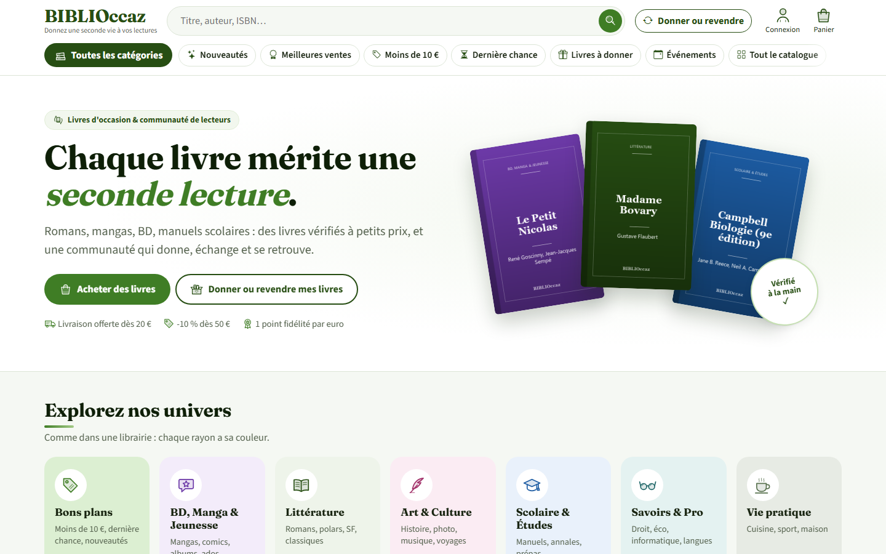
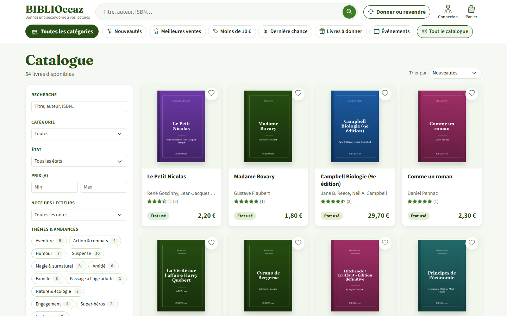
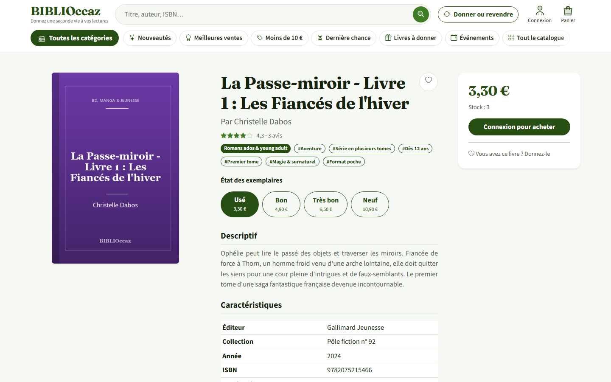
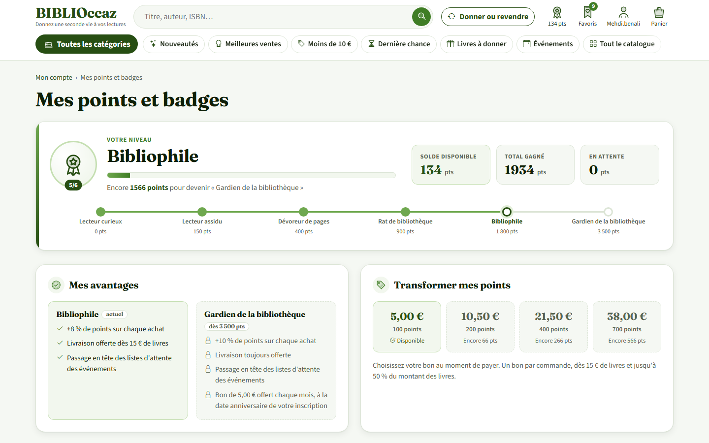
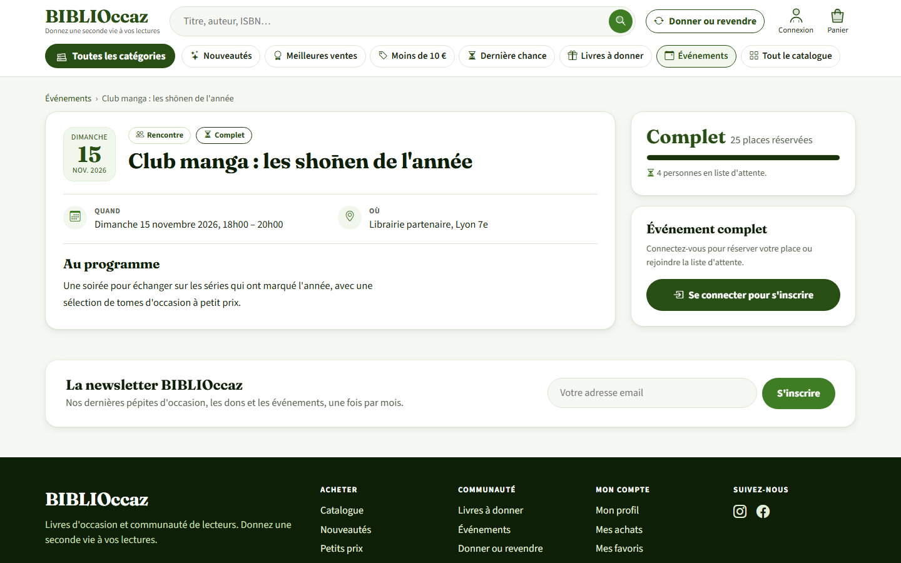
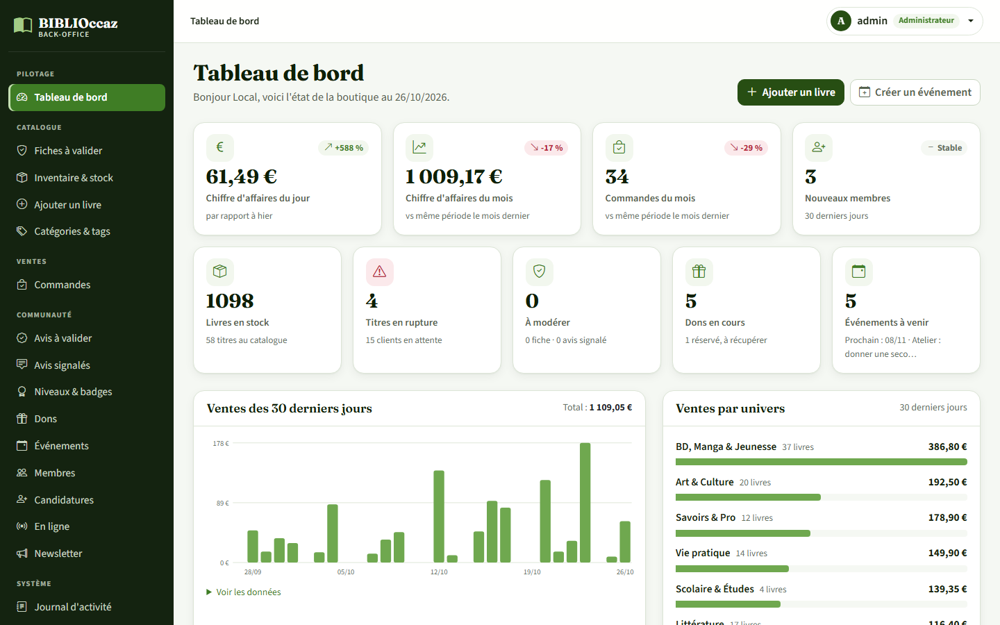
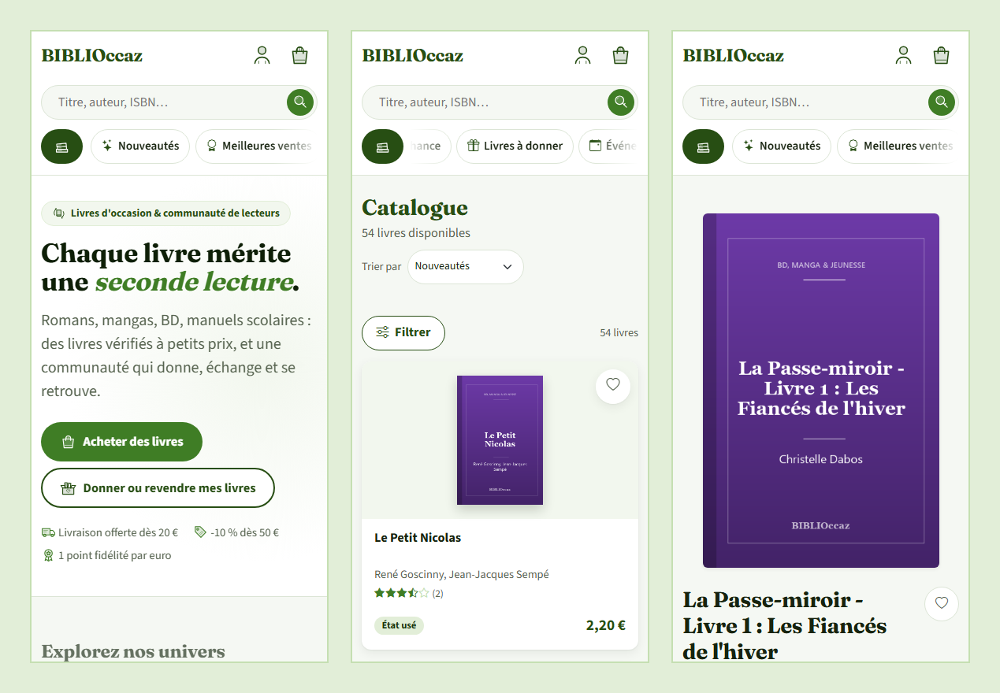

# BIBLIOccaz

Librairie en ligne de livres d'occasion, pensée comme une vraie boutique de quartier : on y achète des livres vérifiés à petit prix, on donne ceux qu'on a lus, on se retrouve à des dédicaces et des ateliers, et chaque action rapporte des points.

Site complet en PHP et MySQL, sans framework : catalogue rangé par univers, panier et commandes, dons avec QR code, événements avec billets, avis modérés, programme de fidélité, et un back-office séparé pour l'équipe.



## Le projet

BIBLIOccaz est né comme **projet annuel de 1re année à l'ESGI** (classe 1A1), réalisé en groupe par **Gaël Fadeyi**, **Jeanny Benon** et **David Radom** : catalogue, panier, comptes, dons et premier back-office.

Je l'ai ensuite **repris et largement étendu** : refonte visuelle complète, univers et méga-menu, événements, programme de points et de badges, back-office repensé, sécurité (requêtes préparées, jetons CSRF, uploads vérifiés), accessibilité, données de démonstration et documentation.

## Aperçu

| Catalogue et filtres | Fiche d'un livre |
|---|---|
|  |  |

| Points, niveaux et badges | Événements |
|---|---|
|  |  |

| Back-office | Sur téléphone |
|---|---|
|  |  |

Les couvertures visibles sur ces captures sont générées pour l'aperçu : les couvertures d'éditeurs ne sont pas diffusées dans le dépôt.

## Fonctionnalités

### Boutique
- **Catalogue en 6 univers** (BD, Manga & Jeunesse, Littérature, Art & Culture, Scolaire & Études, Savoirs & Pro, Vie pratique) et un rayon Bons plans, avec méga-menu, fil d'Ariane, catégories, tags en trois familles (thèmes, public, particularités), filtres (type d'offre : magasin, entre particuliers ou don, prix, état, note), tris et pagination ; filtres repliés dans un volet sur téléphone
- **Fiche livre** : caractéristiques complètes, choix de l'état (neuf, très bon, bon, usé) avec le prix et le stock de chacun, liste « Toutes les offres » (magasin, annonces de particuliers et dons) triable par prix, état ou type, avis des lecteurs, suggestions
- **Panier et commande** : remises automatiques (-5 % dès 30 €, -10 % dès 50 €), livraison offerte dès 20 €, carnet d'adresses, bons de réduction, mail de confirmation ; prix et stocks toujours relus en base, commande verrouillée en transaction
- **Liste d'envies** et **alertes de retour en stock** par mail
- **Recherche** avec suggestions instantanées

### Communauté
- **Emprunts en magasin** : réservation gratuite de trois livres au maximum, retrait sous trois jours ouvrés avec code ou QR, liste d'attente avec attribution automatique, tickets PDF, renouvellements, rappels par mail, suivi des retours et blocages temporaires en cas de retard ; messagerie avec l'équipe, points pour les retours à l'heure et badge « Habitué de la bibliothèque »
- **Revente entre particuliers** : annonce avec prix libre (de 0,50 € à 150 €), état, jusqu'à 3 photos vérifiées, description et mode de remise (main propre ou envoi) ; un livre absent du catalogue crée une nouvelle fiche ; chaque annonce est **vérifiée par l'équipe avant publication** (validation, refus ou retrait avec motif envoyé par mail) ; page « Mes annonces » pour modifier, retirer, remettre en ligne ou supprimer
- **Ventes entre lecteurs** : demande d'achat depuis l'annonce (5 en attente au maximum, expiration après 7 jours sans réponse), acceptation ou refus par le vendeur, **file d'attente** quand le livre est réservé, échange organisé dans la messagerie, paiement direct entre membres, **le vendeur indique la vente conclue** (livre vendu, **reçu PDF** pour les deux), puis l'acheteur a 7 jours pour confirmer la réception ou signaler un litige à l'équipe, page « Mes ventes et achats » ; +10 points vendeur (5 ventes par mois) crédités à la confirmation, ou après 7 jours sans signalement, et badge « Seconde main »
- **Dons de livres** : annonce gratuite avec lieu et date limite de retrait, réservation par un autre lecteur, retrait validé par QR code ou code court
- **Messagerie liée aux transactions** : une conversation s'ouvre à chaque réservation de don ou d'emprunt et à chaque demande d'achat, sans message libre entre membres ni adresse email dévoilée ; bulles, non lus en gras, compteur dans l'entête, mail de notification (au plus un toutes les 15 minutes), anti-spam, conversation fermée en fin de transaction et gardée en lecture seule, signalement d'un message avec motif
- **Événements** (dédicaces, rencontres, ateliers) : calendrier filtrable, inscription dans la limite des places, liste d'attente automatique ou manuelle, billet avec QR code, contrôle des présences le jour J, export PDF des participants, mails en cas d'annulation
- **Événements proposés par les auteurs**, validés ou refusés par l'équipe avec un message
- **Avis** : note, titre et commentaire, un avis par livre, badge « achat vérifié », tri, signalement, modération (un avis masqué reste archivé), page « Mes avis »
- **Newsletter** avec ou sans compte

### Programme de fidélité
- **Points** : 1 point par euro payé, points pour les avis validés, les dons récupérés, les présences aux événements, les ventes entre lecteurs, les emprunts rendus à l'heure (+5 points, cinq récompenses par mois), le premier achat et les badges
- **Bons de réduction** de 5 € à 38 €, utilisables au paiement selon des règles claires (un par commande, plafond de 50 % des livres)
- **Six niveaux de lecteur** avec avantages (livraison offerte plus tôt, priorité sur les listes d'attente, bon d'anniversaire) et **badges** bronze, argent, or et rares
- Page « Mes points et badges » avec la progression et l'historique de chaque mouvement

### Comptes
- Inscription avec confirmation par mail, connexion protégée par un **puzzle captcha** maison vérifié côté serveur, mot de passe oublié avec lien à usage unique valable 1 heure
- Rôles : lecteur, auteur, modérateur, gestionnaire, administrateur ; **candidatures à la modération** avec motivations, étudiées depuis le back-office
- Espace « Mon compte » : profil, photo (recadrée et convertie en WebP), commandes, favoris, alertes, adresses, dons, événements, avis
- Déconnexion automatique après 10 minutes d'inactivité

### Back-office (`admin/`)
- Session séparée du site, droits par rôle, menu latéral et fil d'Ariane
- **Connexions actives** : suivi distinct du site et du back-office, fermeture individuelle ou par membre avec confirmation ; les sessions des autres administrateurs sont protégées, les changements de mot de passe invalident les anciennes connexions
- **Règles de récompenses** : barème de points, plafonds mensuels, seuils des niveaux et paliers des badges modifiables par un administrateur, avec historique des versions et conservation des points déjà gagnés
- **Tableau de bord** : chiffre d'affaires, commandes, nouveaux membres, stock, ventes sur 30 jours et par univers, liste « À traiter »
- **Catalogue** : fiches, exemplaires par état, inventaire avec alertes de rupture, catégories et tags, validation des livres proposés par les auteurs, **modération des annonces** entre particuliers (photos, motif de refus ou de retrait, modification par l'équipe), **suivi des ventes entre lecteurs** (ventes en retard, litiges : valider, annuler avec retrait des points, classer)
- **Commandes** : liste filtrable, fiche détaillée, annulation (stock remis, points rendus, client prévenu)
- **Communauté** : avis à valider et signalés, messages signalés (masquer un message, clore une conversation, suspendre un compte), dons, événements et présences, niveaux et badges des membres, membres (rôles, suspension), candidatures, utilisateurs en ligne, newsletter
- **Système** : journal d'activité, images du captcha, export PDF des membres

### Qualité
- Requêtes préparées partout, échappement de toutes les sorties, **jeton CSRF** sur chaque formulaire qui modifie des données, uploads vérifiés (contenu réel, taille, renommage)
- Mails au **gabarit commun** aux couleurs du site, avec version texte
- Responsive du téléphone au grand écran, menus qui restent toujours dans l'écran
- Accessibilité : contrastes suffisants, libellés reliés aux champs, textes alternatifs, focus visible au clavier, zones tactiles d'au moins 44 px sur écran tactile
- Page 404 aux couleurs du site

## Technologies

PHP 8.2 (PDO) · MySQL / MariaDB · HTML, CSS et JavaScript sans framework · Bootstrap 5 · PHPMailer · Dompdf · Composer · Git

## Installation pas à pas (Windows + XAMPP)

### 1. Prérequis
- [XAMPP](https://www.apachefriends.org) (PHP 8.2, MariaDB) et [Composer](https://getcomposer.org)
- Dans `C:\xampp\php\php.ini`, activer l'extension **GD** (retirer le `;` devant `extension=gd`) : elle sert au captcha et aux photos de profil
- Démarrer **Apache** et **MySQL** depuis le panneau XAMPP

### 2. Récupérer le projet
```bash
cd /c/xampp/htdocs
mkdir -p projet_web && cd projet_web
git clone https://github.com/gfadeyi/biblioccaz.project.git biblioccaz
cd biblioccaz
composer install
mkdir -p secure_data img/captcha
touch secure_data/logs.txt
cp img/Biblioccaz_Logo_New.png img/captcha/
```

### 3. Créer la base
`sql/biblioccaz.sql` crée la base `biblioccaz`, son utilisateur MySQL et toutes les tables (il contient déjà toutes les migrations) :
```bash
/c/xampp/mysql/bin/mysql.exe -u root --default-character-set=utf8mb4 < sql/biblioccaz.sql
```
L'option `--default-character-set=utf8mb4` est importante : sans elle, les accents sont abîmés.

### 4. Ajouter les données de démonstration (facultatif)
Une cinquantaine de livres aux ISBN vérifiés, des lecteurs à tous les niveaux, des commandes, des avis, des dons et des événements, avec des dates calculées à partir du jour de l'import :
```bash
/c/xampp/mysql/bin/mysql.exe -u root --default-character-set=utf8mb4 biblioccaz < sql/donnees_demo.sql
/c/xampp/php/php.exe sql/verifier_encodage.php
```
Les couvertures d'éditeurs ne sont pas versionnées : les livres concernés affichent la couverture par défaut.

### 5. Configurer
Copier `secrets.example.php` en `secrets.php` et y renseigner l'accès à la base, l'adresse du site et l'envoi des mails. Ce fichier est ignoré par Git.

### 6. Recevoir les mails en local
Lancer [Mailpit](https://github.com/axllent/mailpit) : les mails du site (confirmation d'inscription, commande, mot de passe…) sont capturés sur http://localhost:8025, sans rien envoyer réellement. C'est la configuration par défaut de `secrets.example.php` (SMTP `localhost:1025`).

### 7. Ouvrir le site
- Site : http://localhost/projet_web/biblioccaz/
- Back-office : http://localhost/projet_web/biblioccaz/admin/

Le script d'installation crée un compte administrateur initial. Remplace son mot de passe dès la première connexion et conserve les identifiants dans ta configuration privée.

Si le projet est installé dans un autre dossier que `/projet_web/biblioccaz/`, adapter le chemin de la page 404 dans `.htaccess` et `SITE_URL` dans `secrets.php`.

### Mettre à jour une base existante
Chaque évolution de structure a sa migration `sql/maj_<sujet>.sql`, rejouable sans erreur :
```bash
/c/xampp/mysql/bin/mysql.exe -u root --default-character-set=utf8mb4 biblioccaz < sql/maj_candidatures.sql
```

Pour les emprunts, sauvegarder la base avant toute mise à jour. Si les tables F5 n'existent pas, appliquer `sql/maj_emprunts.sql`, puis `sql/maj_emprunts_securite.sql`. Si F5 est déjà installé mais que `emprunt.blocage_retard` manque, seule `sql/maj_emprunts_securite.sql` est nécessaire : elle conserve le réglage de pénalité de chaque emprunt existant à partir de son exemplaire. Les prochaines réservations prennent leur propre instantané. L'installation complète contient déjà cette structure.

Pour le suivi individuel des connexions, sauvegarder la base puis appliquer `sql/maj_sessions.sql`. Les sessions anciennes devront se reconnecter après la mise à jour. Sans cette migration, la page de supervision indique que les révocations sont indisponibles.

Pour administrer les récompenses, appliquer après sauvegarde `sql/maj_regles_recompenses.sql`. Sans cette migration, les règles historiques restent utilisées. Le [guide des récompenses](docs/regles-recompenses.md) précise les effets des changements et leurs limites.

## Organisation du code

| | Site | Back-office |
|---|---|---|
| Adresse | `/` | `/admin/` |
| Public | visiteurs, lecteurs, auteurs | administrateur, gestionnaire, modérateur |
| Connexion | `login.php` | `admin/login.php` (session séparée) |
| Mise en page | `header.php` / `footer.php` | `admin/_haut.php` / `admin/_bas.php` |

Code partagé : `config.php` (connexion, session), `mailer.php` (mails), bibliothèques `*_lib.php` (points, dons, événements, avis, commandes…), `style.css` et `javascript/`.

Droits dans le back-office (`admin/_init.php`) :
- **Modérateur** : tableau de bord, fiches à valider, annonces, avis, messages, dons
- **Gestionnaire** : en plus, livres, stock, commandes, événements et emprunts (mise à disposition, retrait, retour et levée motivée des blocages)
- **Administrateur** : tout, dont membres, candidatures, catégories, newsletter, journal, captcha et export PDF
